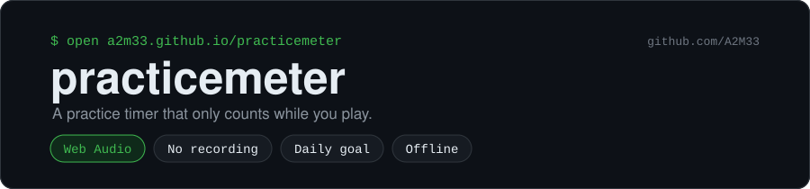
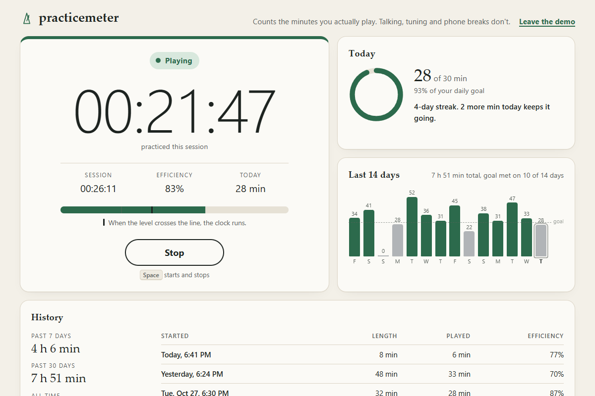

<p align="center"></p>

<p align="center">
  <a href="https://a2m33.github.io/practicemeter/"></a>
  <a href="https://github.com/A2M33/practicemeter/actions/workflows/test.yml"></a>
  <a href="https://github.com/A2M33/practicemeter/blob/main/LICENSE"></a>
</p>

practicemeter is a practice timer for musicians that counts the time your instrument makes sound. Put your phone on the music stand, press Start and play. Stop to talk to your teacher or read a message, and the clock stops with you.

**Try it:** https://a2m33.github.io/practicemeter/



## The idea

A normal timer counts everything between Start and Stop. You set it for an hour, spend ten minutes tuning and answering texts, and at the end it still says an hour. practicemeter listens through the microphone and adds time while you play. Short gaps between phrases stay on the clock, so a breath or a page turn costs you nothing.

At the end of a session you see how long you sat there and how long you played. Divide the second by the first and you get your efficiency.

## Features

- A big practice clock with three states: Playing, Short pause and Paused. Each state has its own label and shape as well as a colour.
- Session length and efficiency next to the clock
- A live level meter with the threshold line, so you can see what the app hears
- A sensitivity slider. Raise it for quiet instruments or a distant phone and lower it in a noisy room.
- A pause allowance you can set from 1 to 10 seconds (3 by default)
- A daily goal with a progress ring, set to 30 minutes until you change it
- A bar chart of the last 14 days with the minutes printed on each bar
- A streak count of consecutive days on which you reached your goal
- CSV export of your daily totals and a button to reset the history
- The screen stays awake while the app listens, in browsers that support the Screen Wake Lock API.
- If you unplug the microphone or a call takes it over, the session stops, keeps the time you played and tells you what happened.
- Space starts and stops a session, and the app works with a keyboard and a screen reader.
- Light and dark themes that follow your system setting
- Offline use once the page has loaded. You don't sign up for anything, and the app has no server.

## Detection

About 25 times a second the app measures the loudness of the microphone signal in decibels. It spends the first two seconds measuring the room to find the noise floor. From then on it tracks the floor as a low percentile of the last 30 seconds. In a quieter room the floor drops within about a second. In a louder room it waits for 30 seconds of history and then climbs by at most 2 dB per second, so a fan or air conditioner that runs the whole time ends up as background. While the clock runs, the floor climbs only if the last 30 seconds held steady within 6 dB. Your breaths and bow changes dip further than that, so a long legato passage keeps counting.

Sound counts as playing once it rises a set number of decibels above the floor. The sensitivity slider sets that distance between 6 and 24 dB. A sound has to last 150 ms before the clock starts, which filters out a dropped pencil or a knock on the stand. After you stop, the clock holds. If you start again within the pause allowance, the gap counts. If you wait longer, the app drops the gap and pauses.

Loudness alone can't tell a held note from a steady machine hum. Hold one even drone for more than half a minute without a break and the floor may rise towards it. Pieces and scales change volume enough to prevent that.

You'll find the detection code in `detector.js`. It has no browser dependencies, and `tests/detector.test.mjs` runs it against simulated sessions.

## Privacy

Your browser measures the loudness of the sound on your own device. The app doesn't record audio or send it anywhere. Your daily totals and settings sit in your browser's local storage and stay on your device until you export or reset them.

## Run locally

There is no build step. Serve the folder with any static file server, for example Python's:

```sh
git clone https://github.com/A2M33/practicemeter.git
cd practicemeter
python -m http.server 8000
```

Then open http://localhost:8000. Browsers give microphone access to secure pages only, and localhost counts as secure. Opening `index.html` from disk works in some browsers and fails in others.

To look around without a microphone, add `?demo` to the address. Demo mode fills in sample history and a running session and leaves your saved data alone.

Run the tests with Node 18 or newer:

```sh
node tests/detector.test.mjs
node tests/micwatch.test.mjs
```

## License

MIT. See [LICENSE](LICENSE).
